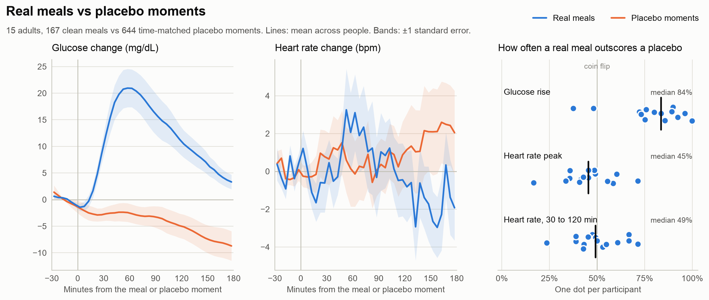
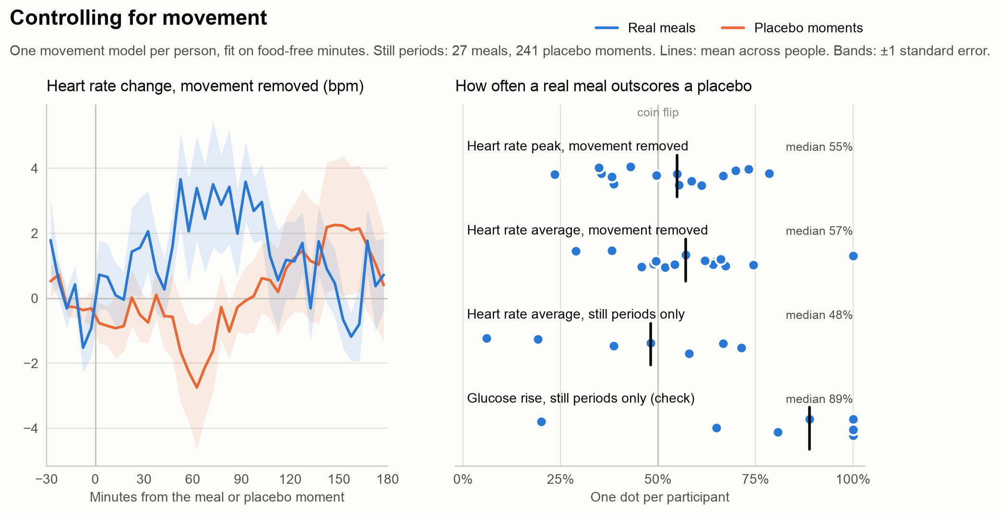

# Placebo meals

**A placebo test for heart rate "meal responses," run on public wearable data.**

Wellness wearables describe how your body responds to food, and one common measure is the change in heart rate after eating. I tested whether that change comes from the meal.

I scored real meals and *placebo moments* the same way. A placebo moment is a time when the same person ate nothing, at the same time of day as a real meal but on a different day. If heart rate responds to food, real meals should score higher.

<picture>
  <source media="(prefers-color-scheme: dark)" srcset="results/figure-dark.png">
  
</picture>

## Result

**Glucose rises far more after real meals than after placebo moments. Heart rate shows no difference.**

| Score | After real meals | After placebo moments | Difference | Real meal scores higher |
|---|---|---|---|---|
| Glucose peak: highest in the {{post_h}} h after, minus the {{pre_min}} min before | {{glucose_meal}} mg/dL | {{glucose_placebo}} mg/dL | {{glucose_diff}} mg/dL | {{glucose_auc}} of the time |
| Heart rate peak: same definition | {{hr_peak_meal}} bpm | {{hr_peak_placebo}} bpm | {{hr_peak_diff}} bpm | {{hr_peak_auc}} of the time |
| Heart rate average: {{sustained_from}} to {{sustained_to}} min after, minus the {{pre_min}} min before | {{hr_sustained_meal}} bpm | {{hr_sustained_placebo}} bpm | {{hr_sustained_diff}} bpm | {{hr_sustained_auc}} of the time |

How to read the table:

- **Every value is a median across {{participants}} people**, taken after summarizing each person.
- **"Difference"** is a person's average after real meals minus their average after placebo moments.
- **"Real meal scores higher"** is the chance that one of a person's real meals beats one of their placebo moments. 50% is a coin flip.

Across people:

- **Glucose** is higher after real meals for {{glucose_positive}} of {{participants}} people ({{glucose_p}}, Wilcoxon signed-rank test).
- **Heart rate peak** is higher for {{hr_peak_positive}} of {{participants}} ({{hr_peak_p}}).
- **Heart rate average** is higher for {{hr_sustained_positive}} of {{participants}} ({{hr_sustained_p}}).

**What it means.** In everyday wrist data, the heart rate peak after a meal reaches about {{hr_peak_meal}} bpm, which looks like a strong response. Placebo moments reach {{hr_peak_placebo}} bpm. A 3-hour peak catches movement, like walking or standing up, along with sensor noise. The movement check below tests that.

Without a placebo comparison, you would read that {{hr_peak_meal}} bpm as a meal response. Glucose, scored the same way, separates meals from placebo moments, so the test can detect a real effect.

## Movement check

The wristband also records motion, so I repeated the test in two ways that take movement out of the picture. I wrote both down in [ANALYSIS_PLAN.md](ANALYSIS_PLAN.md) before running them.

<picture>
  <source media="(prefers-color-scheme: dark)" srcset="results/movement-dark.png">
  
</picture>

1. **Movement removed.**
   - For each person, I fit a model that predicts heart rate from wrist movement over the current and previous 15 minutes.
   - I fit it on minutes at least {{fit_gap_h}} hours after eating, so a meal effect can't leak in.
   - Movement explains a median {{r2_median}} of minute-to-minute heart rate variation (range {{r2_min}} to {{r2_max}}). The lowest is participant {{r2_min_pid}}, whose heart rate has frequent sensor spikes.
   - I then ran the placebo test on the heart rate that movement doesn't explain:
     - Heart rate peak: a real meal scores higher {{adj_hr_peak_auc}} of the time ({{adj_hr_peak_positive}} of {{adj_hr_peak_participants}} people higher, {{adj_hr_peak_p}}).
     - Heart rate average: {{adj_hr_sustained_auc}} of the time ({{adj_hr_sustained_positive}} of {{adj_hr_sustained_participants}} people higher, median difference {{adj_hr_sustained_diff}} bpm, {{adj_hr_sustained_p}}).
2. **Still periods** (exploratory).
   - I planned to keep meals and placebo moments where at least {{still_share}} of minutes were still, both in the {{pre_min}} min before and from {{sustained_from}} to {{sustained_to}} min after.
   - **People kept moving after most meals.** With the loosest planned threshold ({{still_threshold}} g), {{still_meals}} of {{meals}} meals ({{still_meal_share}}) passed, against {{still_placebos}} of {{placebos}} placebo moments ({{still_placebo_share}}).
   - That left {{still_hr_sustained_participants}} people with enough data, under the planned minimum of {{still_min_participants}}, so I report this comparison as exploratory:
     - Heart rate average: a real meal scores higher {{still_hr_sustained_auc}} of the time.
     - Glucose in the same windows, as a check: {{still_glucose_auc}}.

**What it means.** With movement removed, the peak still can't tell meals from placebo moments, so the large peak "response" comes from something other than the meal.

The average gives a hint of a meal effect. With movement removed, heart rate after real meals was higher for {{adj_hr_sustained_positive}} of {{adj_hr_sustained_participants}} people, by a median of {{adj_hr_sustained_diff}} bpm. Digestion raises heart rate a little, so a small rise fits.

The evidence is weak ({{adj_hr_sustained_p}}), and a single real meal beats a placebo moment {{adj_hr_sustained_auc}} of the time. An effect that small, next to everyday movement, can't tell you anything about one meal.

## What I'd do next

- **Test the small average effect under controlled conditions.** Give people the same standardized meal on several days, keep them seated for 2 hours afterward and compare against matched no-meal sessions. That would confirm or rule out the small heart rate rise.
- **Score each meal response against a personal placebo baseline.** Use food-free moments from the same person at the same time of day. The comparison costs little and catches responses that have nothing to do with food.
- **Run the same test on other signals.** Skin temperature and EDA sit in this dataset already, and sensors closer to digestion are the obvious next candidates.

## How it works

1. **Data.** From the dataset description:
   - {{participants_total}} adults aged 35 to 65, with HbA1c in the high-normal to prediabetic range, recorded for 8 to 10 days each.
   - Heart rate from an Empatica E4 wristband, which I averaged per minute.
   - Glucose from a Dexcom G6, every 5 minutes.
   - Timestamped food logs.
2. **Meals.** Food items logged within {{meal_gap}} minutes of each other form one meal. A meal counts as *clean* when the person ate nothing else from {{clean_before_h}} hours before to {{clean_after_h}} hours after it started. That leaves {{meals}} clean meals.
3. **Placebo moments.** For each clean meal, I picked {{placebos_per_meal}} moments that pass the same food-free rule, on other days, within {{clock_window}} minutes of the meal's clock time. That gives {{placebos}} placebo moments.
4. **Scores.** I compared each moment with the {{pre_min}} minutes before it in two ways:
   - Peak: the highest value in the next {{post_h}} hours.
   - Average: the mean from {{sustained_from}} to {{sustained_to}} minutes after.
5. **Statistics.** I compared each person's real meals with their own placebo moments, then summarized across people.
6. **Checks.**
   - Every included participant's heart rate bottoms out between {{low_hour_min}} and {{low_hour_max}} am, so the device clocks run on local time.
   - Glucose peaks a median of {{glucose_ttp}} minutes after logged meals, so the meal times line up with the sensors.

I included {{participants}} of {{participants_total}} people, the ones with at least {{min_meals}} clean meals with usable heart rate and glucose. I left out participant {{excluded}}, whose food log and glucose recording overlap for {{excluded_overlap_hours}} hours.

I wrote the analysis rules down before looking at any heart rate result. They are in [ANALYSIS_PLAN.md](ANALYSIS_PLAN.md), with links to the commits that added them.

## Robustness

- **Leaving out the {{failed_count}} people whose glucose check failed** ({{failed_list}}): real meals outscore placebos {{sens_glucose_auc}} of the time for glucose, {{sens_hr_peak_auc}} for heart rate peak and {{sens_hr_sustained_auc}} for heart rate average.
- **Exploratory checks**, outside the fixed rules:
  - Smoothing heart rate over 5 minutes before taking the peak: {{smooth_auc}}.
  - Large meals (the top third, at least {{big_cut}} kcal, {{big_participants}} people): {{big_glucose_auc}} for glucose, {{big_hr_peak_auc}} for heart rate peak and {{big_hr_sustained_auc}} for heart rate average.

## Limitations

- **Wrist sensor.** The E4 measures heart rate optically at the wrist, and the signal gets noisy during movement.
- **Approximate movement control.** A linear model of wrist motion leaves in other things that change heart rate, like posture, stress or caffeine. It also misses movement that doesn't involve the wrist.
- **Self-reported food logs.** An unlogged snack would make a placebo moment look more like a meal. Snacks like that would blur the glucose result too, and glucose still separates meals from placebo moments, so the logs hold up well enough for this test.
- **Small sample.** {{participants}} people, about a week each.
- **No repeatability measure.** I couldn't use the dataset's repeated standard breakfast for this, because {{sb_count}} of them passed the clean-window rule, from {{sb_participants}} people.
- **Not medical advice.** This is an analysis of a public research dataset for general wellness interest. It makes no claim about any specific product.

## Reproduce

```bash
python3 -m venv .venv && .venv/bin/pip install -r requirements.txt
.venv/bin/python src/download.py
.venv/bin/python src/motion.py
.venv/bin/python run_all.py
```

`src/motion.py` streams the 13 GB of raw accelerometer files once, checks each against its published checksum and keeps a per-minute movement summary of about 7 MB.

`run_all.py` writes `results/metrics.json`, `results/per_participant.csv`, the figures and this README. Every result above comes from that run. To run the tests: `.venv/bin/python -m pytest -q`.

## Data and credit

- Cho P, Kim J, Bent B, Dunn J. *BIG IDEAs Lab Glycemic Variability and Wearable Device Data* (version 1.1.3). PhysioNet, 2026. https://doi.org/10.13026/aw6y-fc44
- Bent B, Cho PJ, Henriquez M, et al. Engineering digital biomarkers of interstitial glucose from noninvasive smartwatches. *npj Digital Medicine* 4, 89 (2021).
- Goldberger A, et al. PhysioBank, PhysioToolkit, and PhysioNet. *Circulation* 101(23): e215-e220 (2000).

The data is under the Open Data Commons Attribution License v1.0 and is not included in this repository. The code is MIT licensed.

Built by Kawsar Nabawi.
